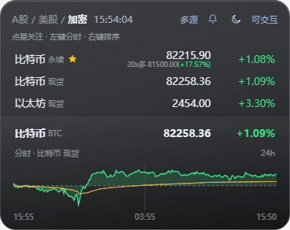

# Stock Widget · A 股 / 美股 / 加密桌面悬浮行情

Windows 桌面置顶悬浮窗，用来看自选股的名称、现价、涨跌幅，以及对应大盘分时。标题处可在 **A股 / 美股 / 加密** 之间切换，三套市场共用同一套界面。基于 Electron，无边框、半透明。默认可以点、可以拖；需要不挡下面窗口时，再在托盘勾选鼠标穿透。

A 股 / 美股行情默认来自**东方财富**，也可换成**腾讯财经**、**新浪财经**。连续多次拿不到数据时，窗口会提示你换一个来源。加密货币现货优先币安，永续优先 Gate（失败会换源），现货与 U 本位永续 24 小时刷新。股票市场**开盘时**约每 5 秒刷新；休市、午休、周末不再请求。启动、切换市场或重载配置时仍会拉一次，用来显示收盘价。

界面示意（加密页）：



## 功能

- 标题 **A股 / 美股 / 加密** 切换，当前市场会写入 `stocks.json` 的 `market`
- 自选股列表：名称 / 现价 / 涨跌幅，最多同时显示 3 行，可用滚轮查看其余股票。名称后跟小号代码，例如 `苹果 AAPL`、`寒武纪 688256`、`比特币 现货`
- 名称代码后的星星可关注。未关注时星星是空心的，只有鼠标移到该行才出现；关注后黄心常亮。关注后会盯短时突变（突然拉升 / 突然下挫），以及拉长时间后仍单边走的阴跌、阴涨（持续下挫 / 持续拉升）。命中后弹系统通知，窗口里该行也会闪一下。A 股 / 美股 / 加密里点过关注的都会盯，**不需要停在那个市场页**；加密全天刷，股票只在各自开盘时段刷。不是看当日累计涨跌幅够不够 5%，而是对比最近几十秒到几分钟走了多少，并按这只标的平时波动自动抬高门槛（加密比股票更钝一点）。永续提醒按**保证金涨跌**（价格变动 × 杠杆，空单方向取反），现货仍看币价
- 右上角铃铛打开提醒列表，收集所有通知。未读有黄点和角标；点一条标已读，也可一键全部已读。最多留 80 条，写在本机 `alerts.json`
- 窗口隐藏且还有未读时，右下角托盘图标会一直闪（普通图标和黄点切换）；点托盘显示窗口或全部已读后停止
- 底部指数可在 `stocks.json` 配置：A 股默认上证，美股默认纳斯达克100，加密默认比特币现货
- 当日分时图（黄线均价）。A 股红涨绿跌，美股 / 加密绿涨红跌。加密分时为近 24 小时 5 分钟线，点列表或底栏会切换对应现货 / 永续，标题如 `分时 · 比特币 现货`
- 左键点某只股票，切换其分时；默认显示当前市场的指数
- 右键自选行：置顶 / 上移 / 下移，顺序写回对应列表（指数行不能调）
- 悬停即可拖动窗口，点击与拖动自动区分
- 默认可点、可拖。托盘可勾选鼠标穿透，勾上后平时不挡下面的窗口，鼠标移到插件上时再暂时可操作
- 太阳 / 月亮两套主题
- 标题旁实时时钟
- 数据来源可切换：东方财富（默认）/ 腾讯财经 / 新浪财经。窗口右上角显示当前来源，托盘右键也可改。连续没有行情时会提示切换。加密页右上角显示「多源」，实际是币安 / Gate / OKX 谁先成功用谁，不能手动改成东财
- 系统托盘：显示 / 隐藏 / 退出。隐藏且有未读时图标闪烁
- 记住窗口位置（本地 `position.json`，不提交到 Git）
- 开盘才定时刷新：A 股（北京时间工作日 9:15–11:30、13:00–15:00），美股（纽约时间工作日 9:30–16:00，已考虑夏令时）。刚收盘会再拉一次，之后停刷。加密市场全天刷新
- 单实例：重复启动会唤起已有窗口，而不是再开一个

## 环境

- Windows 10 / 11

## 安装

第一次用需要先装依赖（主要是 Electron）。**只做一次**；以后日常打开用「启动」那一节即可。

**1. 确认已安装 Node.js**

打开浏览器，打开 [https://nodejs.org](https://nodejs.org)，下载 **LTS** 版本并安装。一路下一步即可。装完后，下面才能用 `npm` 这个命令。

**2. 打开项目所在的文件夹**

例如项目在：

`D:\stock-widget`

（请改成你电脑上的真实路径。如果你是从 GitHub 下载或复制来的，文件夹里应能看到 `package.json`、`启动.vbs` 这些文件。）

**3. 在这个文件夹里打开命令行**

任选一种：

- 打开该文件夹，点窗口上方的地址栏（显示 `D:\stock-widget` 的那一行），把路径全选删掉，输入 `cmd`，按回车。会弹出一个黑色窗口，第一行通常是 `D:\stock-widget>`。
- 或者：按键盘 `Win + R`，输入 `cmd`，回车。然后输入下面这行，把路径换成你的，再回车：

```bat
cd /d D:\stock-widget
```

**4. 安装依赖**

在黑色窗口里输入下面这一行，按回车（不要漏掉中间的空格）：

```bat
npm install
```

等待几分钟。它会在这个文件夹里生成 `node_modules`，体积比较大（常见几百 MB 到 1 GB 多），属正常现象。最后没有大段红色报错、又重新出现 `D:\stock-widget>` 提示符，就说明装好了。

如果提示 `npm` 不是内部或外部命令，说明 Node.js 没装好，或装完还没重新打开命令行：关掉黑窗，再从第 3 步重来。

## 启动

推荐双击 `启动.vbs`（无黑色命令行窗口）。

也可以：

- 双击 `启动.bat`
- 或在本目录执行 `npm start`

关闭请用托盘图标右键 **退出**。只关窗口或点任务栏，进程可能还在。左键托盘可切换显示 / 隐藏。有未读提醒时把窗口藏起来，托盘图标会闪。

改代码后如果界面没变，多半是旧进程还占着单实例锁：先托盘退出，再重新启动。

## 配置

自选股和部分选项写在本机的 `stocks.json`。这个文件只留在你电脑上，**不会提交到 GitHub**。仓库里只有模板 `stocks.example.json`；如果本地还没有 `stocks.json`，启动时会自动复制一份。

```json
{
  "refreshIntervalMs": 5000,
  "opacity": 0.88,
  "clickThrough": false,
  "theme": "sun",
  "market": "cn",
  "quoteProvider": "eastmoney",
  "alertSensitivity": 1,
  "cnIndex": {
    "secId": "1.000001",
    "name": "上证指数"
  },
  "usIndex": {
    "secId": "100.NDX100",
    "name": "纳斯达克100"
  },
  "cryptoIndex": {
    "secId": "crypto.BTC.spot",
    "name": "比特币"
  },
  "stocks": [
    { "code": "600519", "cost": 1680, "watch": true },
    { "code": "000001", "cost": 0 },
    { "code": "300750", "cost": 0 },
    { "code": "601318", "cost": 0 },
    { "code": "000858", "cost": 0 },
    { "code": "002594", "cost": 0 }
  ],
  "usStocks": [
    { "code": "AAPL", "cost": 0 },
    { "code": "NVDA", "cost": 120.5 },
    { "code": "TSLA", "cost": 0 },
    { "code": "MSFT", "cost": 0 },
    { "code": "GOOGL", "cost": 0 },
    { "code": "AMZN", "cost": 0 }
  ],
  "cryptoStocks": [
    { "code": "BTC", "cost": 0 },
    { "code": "BTC-PERP", "cost": 80000, "leverage": 10, "side": "buy" },
    { "code": "ETH", "cost": 0 },
    { "code": "ETH-PERP", "cost": 0, "leverage": 5, "side": "sell" }
  ]
}
```

| 字段 | 说明 |
|------|------|
| `market` | 当前市场：`cn` 为 A 股，`us` 为美股，`crypto` 为加密。也可在窗口标题点击切换 |
| `quoteProvider` | 行情来源：`eastmoney` 东方财富（默认），`tencent` 腾讯财经，`sina` 新浪财经。也可在窗口或托盘切换 |
| `cnIndex` | A 股底栏指数。至少写 `secId`（东方财富代码）。`name` 可省略，不写则用接口返回的名称 |
| `usIndex` | 美股底栏指数，格式同上。默认 `"100.NDX100"`（纳斯达克100）。东财的 `"100.NDX"` 实际是纳斯达克综合指数，不要和 100 搞混 |
| `stocks` | A 股自选。每项 `{ "code": "600519", "cost": 0 }`。`code` 为 6 位代码，`6` 开头按沪市处理，其余按深市 |
| `usStocks` | 美股自选，格式同上，如 `{ "code": "AAPL", "cost": 0 }`。纽交所 / 纳斯达克会自动识别 |
| `cryptoIndex` | 加密底栏，默认比特币现货。`secId` 用 `crypto.BTC.spot` 或 `crypto.ETH.perp` |
| `cryptoStocks` | 加密自选。目前只认 **BTC / ETH**：`BTC` / `ETH` 为 USDT 现货，`BTC-PERP` / `ETH-PERP` 为 U 本位永续 |
| `code` | 股票或币种代码 |
| `watch` | 是否关注。`true` 后星星黄心常亮，并开始盯短时突变。也可在窗口里点星星切换 |
| `alertSensitivity` | 提醒灵敏度，默认 `1`。改成 `0.7` 更敏感（更容易提醒），`1.4` 更钝（少提醒）。短时突变最短约 1 分钟。另外会看 15 / 30 / 60 分钟是否一直单边走（加密按保证金涨跌）。同向突变约 4 分钟内不重复报，持续阴跌/阴涨约 12 分钟 |
| `cost` | 成本价 / 永续开仓价。默认 `0` 表示未设置，窗口不显示。现货显示 `成本 14.34(+0.85%)` |
| `leverage` | 仅永续。杠杆倍数，如 `10`。未写则按 1x。窗口盈亏和关注提醒都按这个倍数算 |
| `side` | 仅永续。`buy` 买入做多，`sell` 卖出做空。也可用 `多` / `空`。永续小字为 `10x多 80000(+12.30%)`，括号里是保证金盈亏（涨跌幅×杠杆）。右侧今日涨跌仍是行情 24 小时涨跌 |
| `refreshIntervalMs` | 开盘时的行情刷新间隔，毫秒。休市不生效 |
| `opacity` | 窗口透明度 |
| `clickThrough` | 是否鼠标穿透。默认 `false`（可交互，方便拖动）。需要不挡下层窗口时再设为 `true`，或在托盘勾选 |
| `theme` | `sun` 浅色玻璃，`moon` 更深底色。也可在窗口里点太阳 / 月亮按钮切换 |

改完配置后，可用 `Ctrl+Shift+R` 重新加载，不必重启。

底栏指数用东方财富 `secId`。A 股常见：`1.000001` 上证、`0.399001` 深证成指、`1.000300` 沪深300。美股常见：`100.NDX100` 纳斯达克100、`100.NDX` 纳斯达克综合（东财代码叫 NDX，国际代码是 IXIC）。不要把深市 `000001` 当成上证。  
美股分时时段按北京时间约为 `21:30-04:00`（冬令时约为 `22:30-05:00`）。  
刷新只看**当前标题选中的市场**是否开盘，不处理节假日停牌（节假日若落在工作日时段仍会刷）。加密不受开盘时间限制。关注提醒会在后台刷另外两个市场，不要求你停在那一页。

加密行情代码在 `lib/quotes/crypto.js`（拉现货/永续报价和 24h 分时），合约名解析在 `lib/symbols.js` 的 `parseCryptoInstrument`。现货优先币安，永续优先 Gate，失败换 OKX。目前只接比特币和以太坊，其它代码不会出现在列表里。

## 操作

| 操作 | 作用 |
|------|------|
| 标题 A股 / 美股 / 加密 | 切换市场 |
| 悬停后拖动 | 移动窗口 |
| 滚轮 | 列表超过 3 行时滚动 |
| 左键股票 | 切换分时 |
| 点星星 | 关注 / 取消关注 |
| 右上角铃铛 | 打开提醒列表；点一条已读，或「全部已读」 |
| 右键股票 | 置顶 / 上移 / 下移 |
| 太阳 / 月亮按钮 | 切换主题 |
| 右上角 东财 / 腾讯 / 新浪 | 切换 A 股 / 美股数据来源。加密页显示「多源」，悬停可看三家，不能点选 |
| `Ctrl+Shift+T` | 切换穿透 / 可交互 |
| `Ctrl+Shift+R` | 重新加载 `stocks.json` |
| 托盘左键 | 显示或隐藏。隐藏且有未读时图标闪烁 |
| 托盘右键 | 数据来源、鼠标穿透勾选、退出 |

未打包运行时支持开发热更新：保存 `renderer/` 会刷新窗口；保存 `main.js` / `preload.js` 会自动重启；保存 `stocks.json` 会重载配置。打成 exe 后不会监听文件。

## 目录说明

```
stock-widget/
├── main.js          主进程：窗口、托盘、行情、关注提醒、位置记忆
├── preload.js       渲染进程安全桥接
├── lib/quotes/      东方财富 / 腾讯 / 新浪 / 加密行情
├── lib/quotes/crypto.js  币安 / Gate / OKX 现货与永续
├── lib/symbols.js   含加密 BTC/ETH 现货、永续代码解析
├── stocks.example.json  自选股模板（可提交）
├── stocks.json      本机自选与选项（已忽略，不上传）
├── alerts.json      本机提醒记录（已忽略，不上传）
├── icon.png         托盘图标
├── screenshot.png   README 界面示意
├── 启动.vbs         无黑窗启动
├── 启动.bat         命令行启动
└── renderer/        界面：列表、关注星、提醒列表、分时 canvas
```

`stocks.json`、`alerts.json` 和 `position.json` 只在本机使用，已加入 `.gitignore`，不会上传到 GitHub。

## 打包（可选）

```bat
npm run dist
```

会打出 Windows 便携 exe。未签名时，别人电脑上可能被 SmartScreen 拦截。也可以把整个项目（含已安装的 `node_modules`）拷走使用，体积会很大。

## 说明

- 仅供个人看盘，数据以来源网站公开接口为准，不构成投资建议。查不到的股票该行显示 `--`，列表末尾会提示「部分数据未查询到」；没有分时就显示暂无分时，不会改用其他来源
- 加密目前只支持 BTC、ETH 的 USDT 现货和 U 本位永续。提醒列表和托盘闪烁只针对关注后的突变 / 持续单边，不是每笔行情都报
- 东方财富实时接口不通时会自动改走其延迟行情接口；若整家都没数据，请手动换成腾讯或新浪
- 运行时大约会有多个 Electron 进程，内存占用高于普通小工具，属 Electron 常态
- `启动.vbs` 隐藏控制台，崩溃时看不到报错；排查可改用 `npm start`
